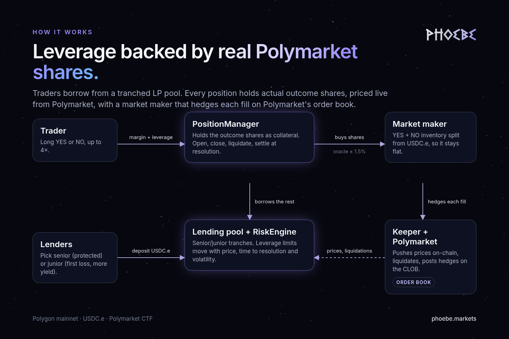
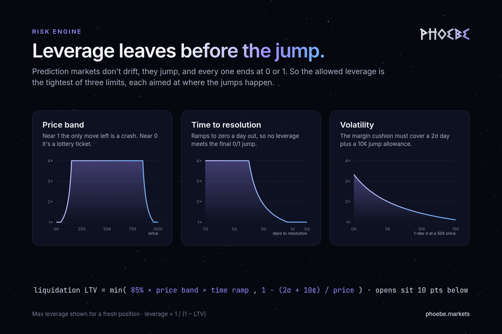
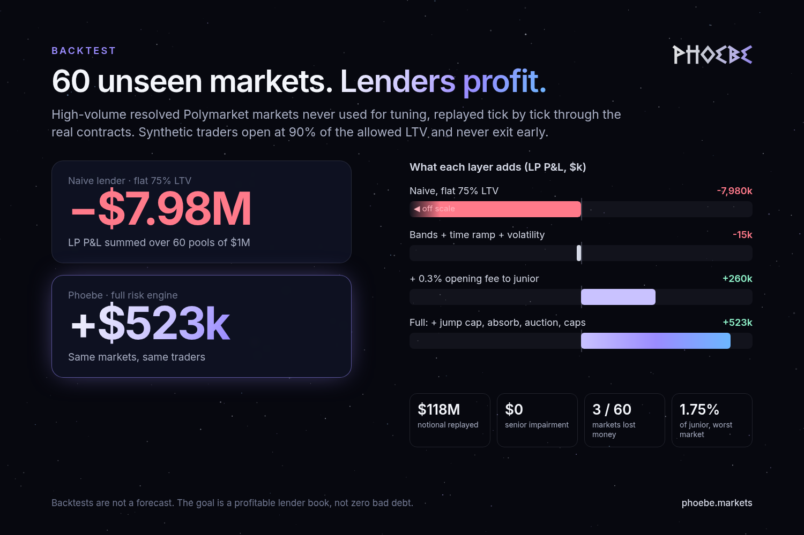

<p align="center">
  <a href="https://phoebe.markets"></a>
</p>

<p align="center">
  <a href="https://phoebe.markets"><b>phoebe.markets</b></a> ·
  <a href="https://phoebe.markets/app/">Launch app</a> ·
  <a href="https://phoebe.markets/app/?net=amoy">Testnet</a> ·
  <a href="sim/RESULTS.md">Backtest</a> ·
  <a href="#contracts-polygon-mainnet">Contracts</a>
</p>

<p align="center">
  
  
  
</p>

**Phoebe is leveraged trading on Polymarket.** Traders post USDC.e margin, borrow from a two-tranche lending pool,
and hold real Polymarket outcome shares as collateral, at up to 4×. Lenders choose **senior** (paid first, loses last) or
**junior** (first loss, paid in higher interest plus every opening and liquidation fee).

Lending against prediction markets is hard because prices *jump*, and every market ends in a jump to 0 or 1.
Phoebe's risk engine is built and backtested around exactly that.

> [!WARNING]
> Real money and unaudited contracts. The mainnet beta runs with small hard caps (senior $200, junior $100,
> $40 per position). Leveraged positions can be liquidated and lenders can take losses.

## How it works



1. **Open:** the PositionManager borrows from the pool and buys real Polymarket YES or NO shares through the venue,
   then holds them as collateral.
2. **Execution:** a transaction can't wait on Polymarket's off-chain order book, so the venue fills from a market
   maker's inventory at the oracle price ± 1.5%. The maker stocks inventory by splitting USDC.e into matched YES + NO
   pairs on Polymarket's Conditional Tokens contract, so the inventory carries no market risk, and hedges what's
   left over on Polymarket's order book.
3. **Keeper:** pushes Polymarket prices on-chain, liquidates (the bonus rises 1%/h until someone takes it), absorbs
   positions too far gone to liquidate into pool inventory, and settles everything at resolution by redeeming on
   Polymarket's contract.
4. **Losses** fall on junior first. Junior must cover at least 20% of outstanding debt, so it can't withdraw ahead of
   a loss it can see coming.

## The risk engine



```
liquidation LTV = min( 85% × price band × time ramp ,  1 − (2σ₁d + 10¢) / price )      opens sit 10 points below
```

- **Price band:** no leverage near 0 or 1, where the only move left is a jump.
- **Time ramp:** leverage reaches zero a day before resolution, so nothing leveraged is left open for the final 0/1 jump.
- **Volatility + jump cap:** the margin cushion covers a 2σ day plus a 10¢ jump; turbulent markets deleverage
  while positions are still solvent.
- **Concentration:** per-market and per-group borrowing caps, per-position size caps, guardian switches.

## Backtest



60 high-volume resolved Polymarket markets held out from tuning, replayed tick by tick through the real contracts:
a naive lender at a flat 75% limit loses **−$7.98M**; Phoebe's lenders make **+$523k**, with **$0** senior
impairment. Method and full results: [`sim/RESULTS.md`](sim/RESULTS.md).

## Contracts (Polygon mainnet)

| Contract | Address |
|---|---|
| PositionManager | [`0x5c1A0aeb70dECf77e22318Ae1feDCcA97B9CcF59`](https://polygonscan.com/address/0x5c1A0aeb70dECf77e22318Ae1feDCcA97B9CcF59) |
| LendingPool | [`0x284691A99e895A581Cbb61b30A555aBbdc52b032`](https://polygonscan.com/address/0x284691A99e895A581Cbb61b30A555aBbdc52b032) |
| Senior vault (ERC-4626) | [`0x2d9A079910380d72033793c7fef510b52fbD5Ddb`](https://polygonscan.com/address/0x2d9A079910380d72033793c7fef510b52fbD5Ddb) |
| Junior vault (ERC-4626) | [`0xAeE2227a355D0b20b510F4Ff75B4Ce434d71D6DA`](https://polygonscan.com/address/0xAeE2227a355D0b20b510F4Ff75B4Ce434d71D6DA) |
| RiskEngine | [`0xBEeb4d4607C624fc00D9e5Ef6a78fC3E158aEBA1`](https://polygonscan.com/address/0xBEeb4d4607C624fc00D9e5Ef6a78fC3E158aEBA1) |
| KeeperOracle | [`0xC010d03B8f2DeFF4eb43218FD3B91d7ff6c172FB`](https://polygonscan.com/address/0xC010d03B8f2DeFF4eb43218FD3B91d7ff6c172FB) |
| KeeperVenue | [`0x61162DEF468ed0f4BdBCeAAac3bCD641Bb48661D`](https://polygonscan.com/address/0x61162DEF468ed0f4BdBCeAAac3bCD641Bb48661D) |

Pool asset: USDC.e (`0x2791…4174`), the collateral Polymarket's shares redeem for. Full deployment:
[`deployments/polygon.json`](deployments/polygon.json).

## Repository

| Path | What |
|---|---|
| [`contracts/`](contracts) | Foundry: `LendingPool`, `TrancheVault` (senior/junior), `RiskEngine`, `PositionManager`, `KeeperOracle`, `KeeperVenue`; unit tests and a Polygon mainnet-fork suite against Polymarket's live contracts |
| [`keeper/`](keeper) | Bun + viem keeper: oracle pushes, liquidation / absorb / settlement, and the hedger (`hedger.ts`) that keeps the market maker flat |
| [`web/`](web) | Vite + React + wagmi: landing page and app (trade, positions, LP tranches, live risk breakdown). Reads everything from chain |
| [`sim/`](sim) | Backtesting on real Polymarket price histories ([`RESULTS.md`](sim/RESULTS.md)) |
| [`demo/`](demo) | `replay.sh` (local historical replay), `amoy.sh` (testnet), `polygon.sh` (mainnet runbook), `site.sh` (publish the site), `gallery/` (images) |
| [`NOTES.md`](NOTES.md) | Design notes and open items |

## Run it

```sh
# contracts: unit tests, then the mainnet-fork suite (needs an archive RPC)
cd contracts && forge test
POLYGON_RPC=https://polygon.drpc.org forge test --mc PolygonFork

# local demo: the Biden 2024 nomination market replayed through a live local chain
cd keeper && bun install && cd ..
demo/replay.sh sim/data/biden-nominee.json -- --speed 20 --traders 12

# UI (another terminal): http://localhost:5173 (landing), http://localhost:5173/app/?net=local (app)
cd web && bun install && bunx vite
```

Locally the app signs with Anvil's demo accounts (Trader / Senior LP / Junior LP picker), so you don't need a wallet.
Mainnet operations (deploy, keeper service, inventory, pause) are in [`demo/polygon.sh`](demo/polygon.sh).

## What's next

- Polymarket deposit-wallet order flow for the hedger (Polymarket moved API trading to deposit wallets in 2026)
- Audit, multisig owner, separate keys for oracle, liquidator and maker
- Multi-outcome (neg-risk) markets, automatic pausing on breaking news, higher caps
